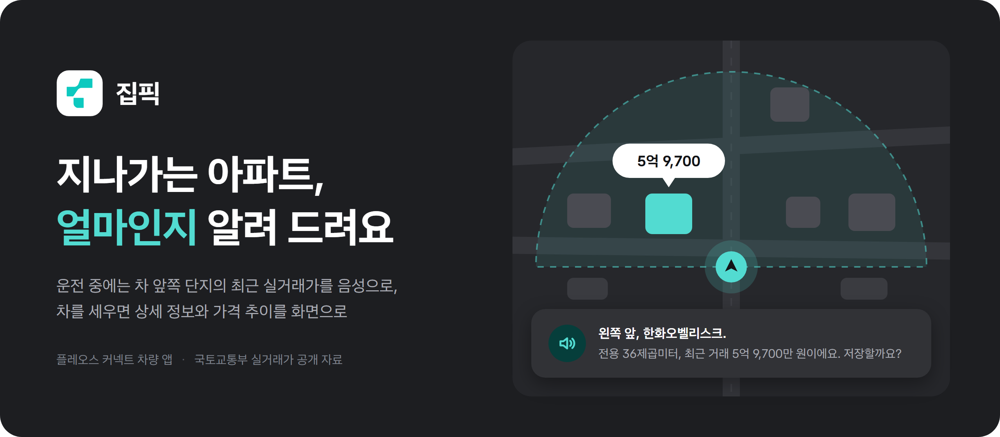
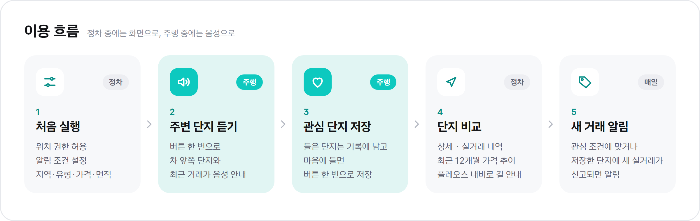
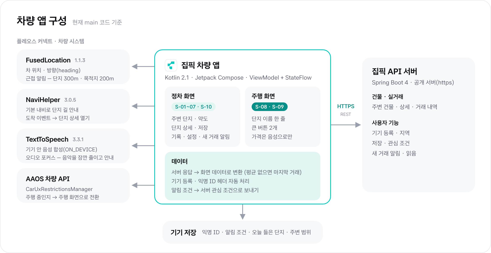

<p align="center">
  
</p>

# 집픽 (Zippick) 차량 앱

[](https://github.com/GooodHandleTruck-Hyndai/frontend/actions/workflows/android-ci.yml)

> 지나가는 아파트, 얼마인지 알려 드려요.
> 주행 중에는 음성으로, 정차하면 화면으로 주변 단지의 최근 실거래가를 보여 주는 플레오스 커넥트 차량 앱

- 현대자동차그룹 차량용 앱 개발 공모전 출품작 · 팀 GooodHandleTruck
- **APK: [`apk/GooodHandleTruck_Zippick_release.apk`](apk/GooodHandleTruck_Zippick_release.apk)** (release, 공개 서버 연결)
- 공개 서버: `https://3-37-254-181.sslip.io` · [API 문서(Swagger)](https://3-37-254-181.sslip.io/swagger-ui.html)
- 백엔드 저장소: [backend](https://github.com/GooodHandleTruck-Hyndai/backend)
- 협업 규칙(브랜치·커밋·PR): [CONTRIBUTING.md](CONTRIBUTING.md)

## 목차
1. [해결하려는 문제](#해결하려는-문제)
2. [핵심 기능](#핵심-기능)
3. [이용 흐름](#이용-흐름)
4. [앱 화면](#앱-화면)
5. [기술적으로 고민한 점](#기술적으로-고민한-점)
6. [시스템 구성](#시스템-구성)
7. [실행 방법](#실행-방법)
8. [테스트 환경 및 설정](#테스트-환경-및-설정)
9. [개발 환경](#개발-환경)
10. [향후 계획](#향후-계획)
11. [개발자 가이드](#개발자-가이드)

---

## 해결하려는 문제

- 운전 중 "저 아파트 얼마지?" 싶어도 휴대폰으로 시세를 찾아볼 수 없음
- 부동산 앱은 단지 이름을 알아야 검색 가능, 지나가며 본 단지는 이름도 모르는 경우가 많음
- 정차 후 다시 찾으려 해도 어느 단지였는지 기억나지 않음

**집픽의 방식**
- 주행 중: 버튼 한 번 → 차 앞쪽 단지와 최근 거래가를 음성으로 안내, 화면은 최소한으로
- 정차 중: 주변 단지 약도·목록, 평형별 가격, 실거래 내역을 화면으로 확인
- 관심 단지 저장 → 새 실거래가 신고되면 알림
- 데이터 출처: 국토교통부 실거래가 공개 자료(공공데이터포털)

---

## 핵심 기능

상태 기준: 이 저장소(main)와 [백엔드 저장소](https://github.com/GooodHandleTruck-Hyndai/backend)

| 기능 | 내용 | 화면 |
|---|---|---|
| 주변 단지 | 현재 위치 반경(500m·1km·3km) 안 단지, 약도 가격 말풍선, 가까운 순·가격 순 정렬 | S-03 |
| 주변 단지 듣기 | 주행 중 버튼 한 번 → 차 앞쪽 180° 안 가장 가까운 단지를 음성 안내 | S-08 · S-09 |
| 자동 음성 알림 | 알림 조건에 맞는 단지 반경 300m에 들어가면 음성 안내 (같은 단지는 하루 한 번) | S-02 · S-09 |
| 단지 상세 | 평형별 최근 3개월 평균, 최근 거래, 자료 기준일 | S-04 |
| 관심 단지 저장 | 주행 중 [저장] 한 번, 정차 후 저장 목록에서 다시 보기 | S-05 |
| 오늘 들은 단지 | 주행 중 들은 단지 기록 | S-06 |
| 새 거래 알림 | 저장한 단지·관심 조건에 맞는 단지의 새 실거래 | S-10 |
| 길 안내 | 단지를 플레오스 내비 목적지로, 도착하면 상세 열기 | S-04 · S-05 |
| 설정 | 음성 알림 켜기·끄기, 알림 조건, 주변 범위 기본값 | S-07 |

- 시연 지역: 서울 마포구 (서버 실거래 데이터 범위)

---

## 이용 흐름

<p align="center">
  
</p>

1. **처음 실행(정차)** — 위치 권한, 알림 조건 설정. 앱이 익명 ID로 기기 등록(로그인 없음)
2. **주행 중** — [주변 단지 듣기] → 차 앞쪽 단지와 최근 거래가 음성 안내
3. **저장** — 들은 단지는 기록에 남고, 마음에 들면 [저장]
4. **정차 후** — 상세, 실거래 내역 비교, 플레오스 내비로 길 안내
5. **새 거래 알림** — 조건에 맞거나 저장한 단지에 새 실거래가 신고되면 알림

---

## 앱 화면

> 준비 중

| 화면 | 이름 | 설명 |
|---|---|---|
| S-01 | 시작하기 | 서비스 소개, 위치 권한 | 준비 중 |
| S-02 | 알림 조건 | 유형·가격대·면적 선택 | 준비 중 |
| S-03 | 주변 단지 | 약도와 가격 말풍선, 목록·정렬 | 준비 중 |
| S-04 | 단지 상세 | 평형별 가격, 최근 거래, 저장, 길 안내 | 준비 중 |
| S-05 | 저장한 단지 | 저장 순·가까운 순·가격 순 | 준비 중 |
| S-06 | 기록 | 오늘 들은 단지 | 준비 중 |
| S-07 | 설정 | 음성 알림 켜기·끄기, 알림 조건, 주변 범위 기본값 | 준비 중 |
| S-08 | 주행 중 | [주변 단지 듣기] | 준비 중 |
| S-09 | 주행 중 안내 | 음성 안내 중인 단지, [다시 듣기]·[저장] | 준비 중 |
| S-10 | 새 거래 알림 | 저장한 단지의 새 거래 | 준비 중 |

---

## 기술적으로 고민한 점

**1. 주행 중에는 보지 않아도 되게** — 운전자 주의분산 기준
- 주행 중 화면은 단지 이름 한 줄과 큰 버튼 두 개(높이 160dp)만, 가격·목록·지도는 정차 중에만
- 가격은 주행 중 음성으로만 안내 ("왼쪽 앞, ○○단지. 전용 84제곱미터, 최근 3개월 평균 12억 3,000만 원이에요.")
- 주행 상태는 AAOS `CarUxRestrictionsManager` 로 판단, 주행 화면 Activity 만 `distractionOptimized`
- 음성은 오디오 포커스를 `AUDIOFOCUS_GAIN_TRANSIENT_MAY_DUCK` 으로 받아 음악을 잠깐 줄이고 안내
- 영상·반복 애니메이션·긴 스크롤·전체 화면 팝업 없음, 주행 중 서버 호출도 꼭 필요한 것만

**2. 한 코드로 두 가지 앱 창 크기**
- 플레오스 커넥트는 화면을 1:2(1700×1184dp) 또는 1:1:1(840×1184dp)로 나눔
- 넓은 창: 왼쪽 목록 + 오른쪽 상세·약도 두 칸, 카드를 눌러도 목록 스크롤 위치 유지
- 좁은 창: 한 화면씩 쌓고 [뒤로], 약도는 목록 맨 위
- 누를 수 있는 것은 모두 76×76dp 이상, 20sp 보다 작은 글자 없음

**3. Google Play 서비스 없이**
- 플레오스 문서에 지원 안내가 없는 구글 지도·FCM·Google 위치 대신 플레오스 SDK만 사용
- 약도는 지도 타일 없이 앱이 직접 그림 — 차가 향한 쪽이 위, 거리 고리와 번호·가격 말풍선
- 위치·근접 알림은 플레오스 FusedLocation, 방향·거리("오른쪽 · 340m")는 heading 으로 앱에서 계산
- 내비 도착 이벤트가 오지 않는 경우 대비: 목적지 200m 근접 알림 + 정차로 도착 판단

**4. 서버 응답과 화면 사이**
- 화면은 하나의 데이터 모양만 쓰고, 서버 응답 변환은 한 곳(`data/remote/ServerMapping.kt`)에서
- 서버는 주변 단지마다 최근 거래 1건만 줌 → 평균인 척하지 않고 "마지막 거래 · 2026년 11월"처럼 계약 월과 함께 표시
- 평형별 3개월 평균은 실거래 내역을 받아 앱에서 계산, 상세 최근 3건과 내역이 겹쳐 세지 않게
- 기기 등록·익명 ID 헤더(`X-Anonymous-Id`)·재등록은 통신층에서 처리, 화면은 몰라도 됨
- 좌표·층을 모르는 건물: 길 안내 버튼을 막고 "-"로 표시 (0층·(0,0) 길 안내 방지)
- 가격 표기("12억 3,000만", "12.3억")는 유틸 함수 한 곳에서만 생성, 단위 테스트 82개

---

## 시스템 구성

<p align="center">
  
</p>

- 서버 쪽 구성(DB, 외부 공공 데이터, 배치 작업)은 [백엔드 README의 시스템 구성](https://github.com/GooodHandleTruck-Hyndai/backend#시스템-구성) 참고

| 구분 | 기술 |
|---|---|
| 차량 앱 | Kotlin 2.1, Jetpack Compose, MVVM(ViewModel + StateFlow), DI 프레임워크 없이 수동 주입 |
| 플레오스 SDK | FusedLocation 1.1.3 (위치·근접 알림), NaviHelper 3.0.5 (길 안내·도착), TextToSpeech 3.3.1 (음성 안내) |
| 차량 API | AAOS `CarUxRestrictionsManager` (주행 상태) |
| 통신 | OkHttp, kotlinx.serialization |
| 디자인 | Figma 디자인 시스템 변수(색·텍스트 스타일)를 코드로 옮김, 다크 GUI, 글꼴 Asta Sans |
| 서버 | Spring Boot 4 API 서버 — [백엔드 저장소](https://github.com/GooodHandleTruck-Hyndai/backend) |
| CI | GitHub Actions — PR 마다 ktlint 검사, 빌드 |

---

## 실행 방법

| 방법 | 내용 |
|---|---|
| APK 설치 (심사용) | `apk/GooodHandleTruck_Zippick_release.apk` — 공개 서버에 바로 연결, 서버 준비 불필요 |
| 소스 빌드 | Android Studio + Pleos Connect 에뮬레이터 — [아래](#소스로-빌드) |

### APK 설치

```bash
adb install -r apk/GooodHandleTruck_Zippick_release.apk
adb emu geo fix 126.9455 37.5404     # 에뮬레이터 위치를 마포구 도화동으로 (경도가 먼저)
```

1. Pleos Connect 에뮬레이터 실행 ([개발 환경](#개발-환경) 참고)
2. 위 명령으로 설치·위치 이동 (Extended controls(⋯) → Location 에서 위도 `37.5404`, 경도 `126.9455` 입력도 가능)
3. 앱 목록에서 **집픽** 실행 → [위치 권한 허용하고 시작하기] → 알림 조건 → 주변 단지

### 소스로 빌드

```bash
git clone https://github.com/GooodHandleTruck-Hyndai/frontend.git
./gradlew assembleRelease   # Windows PowerShell: .\gradlew.bat assembleRelease
```

- 결과: `app/build/outputs/apk/release/app-release.apk` (공개 서버 연결, 개발용 키로 서명)
- debug 빌드(Android Studio ▶ Run)는 이 PC 의 로컬 서버 `http://10.0.2.2:8080` 에 연결 → 로컬 서버는 [백엔드 README](https://github.com/GooodHandleTruck-Hyndai/backend#docker-로-한-번에-실행) 의 Docker 한 번에 실행 참고
- 단위 테스트 `./gradlew test` · 코드 스타일 `./gradlew ktlintCheck`

---

## 테스트 환경 및 설정

| 항목 | 내용 |
|---|---|
| 서버 | release APK 는 공개 서버에 연결 (1차 심사 결과 발표일 11/23까지 운영) |
| 데이터 범위 | 서울 마포구만 → 에뮬레이터 위치를 마포구로 옮겨야 단지가 보임 |
| 위치 권한 | 첫 화면에서 허용 (거부하면 주변 단지를 볼 수 없음) |
| 차 방향 | 에뮬레이터는 heading 을 늘 0(북쪽)으로 줌 → 방향 칩은 차가 북쪽을 본다고 보고 계산 |

**주행·정차 바꾸기**
- Extended controls(⋯) → **Car data** 에서 기어 **D** → 주행 화면(S-08), **P** → 보던 화면으로
- 명령: `adb shell cmd hmg_car_service --service drivingstate driving_regulation on` (정차는 `off`)

**주행 중 자동 알림 확인**
1. 정차 중 알림 조건(S-02) 저장 → 음성 알림 켜짐 (S-07 에서 확인)
2. 단지에서 떨어진 곳에서 주행 시작
3. `adb emu geo fix` 로 단지 가까이 이동 → 음성 안내

**문제가 생기면**
- 위치를 못 찾거나 옛 위치가 나오면 플레오스 위치 서비스 재시작 후 앱 다시 실행
  `adb shell am force-stop --user 10 ai.pleos.playground.service.location.fused`
- 첫 실행부터 다시 보기: `adb shell pm clear --user 10 com.gooodhandletruck.zippick` (에뮬레이터에서 앱은 사용자 10)

---

## 개발 환경

| 항목 | 내용 |
|---|---|
| 에뮬레이터 | **Pleos Connect v2.1.0** (Android 14 · API 34) |
| 화면 규격 | Connect-S 17", 앱 창 1:2 분할 **1700×1184dp** · 1:1:1 분할 **840×1184dp** 모두 지원 |
| AVD 설정 | Automotive → Pleos Connect v2.1.0 · RAM 4GB · Default boot Cold |
| 개발 도구 | Android Studio, JDK 17, Android Gradle Plugin 8.7.3 |
| SDK | minSdk 28 · compileSdk / targetSdk 34 |

**에뮬레이터 설치**
1. Android Studio → **Tools → SDK Manager → SDK Update Sites** → **+**
   - Name: `Pleos Connect System Image`
   - Windows / Linux: `https://nexus-playground.pleos.ai/repository/raw-releases/connect-avd/2.x/crp-sys-img.xml`
   - Mac (Apple Silicon): `https://nexus-playground.pleos.ai/repository/raw-releases/connect-avd/2.x/crp-arm64-sys-img.xml`
2. **SDK Platforms** → **Show Package Details** → **Android 14.0 (API 34) › Pleos Connect** 설치
3. **Device Manager → + → Create Virtual Device → Automotive → Pleos Connect v2.1.0**

---

## 향후 계획

- 가격 추이 — 서버의 최근 12개월 월별 평균(API 완료)을 상세 화면 그래프로
- 앞쪽 단지 찾기 서버 연동 — 지금은 주변 단지 응답으로 앱에서 계산, 서버 `identify` API 로 이전
- 주행 중 들은 기록 서버 저장 — 지금은 기기에만 저장
- 오피스텔·원룸 — 서버 데이터가 준비되면 알림 조건에서 선택 가능하게
- 단지 사진 — 응답의 `imageUrl` 이 채워지면 상세에 표시

---

## 개발자 가이드

### 폴더 구조

```
apk/                             제출용 release APK
app/src/main/java/com/gooodhandletruck/zippick/
├── MainActivity.kt / ZippickApp.kt
├── ui/
│   ├── AppRoot.kt               창 크기 판단, 주행·정차 전환, 넓은 창 두 칸
│   ├── AppViewModel.kt          화면 이동, 주행 중 음성 안내·자동 알림
│   ├── navigation/              화면 목록(S-01~S-10)과 이동 규칙
│   ├── nearby/ detail/ saved/ history/ alerts/ settings/ onboarding/ driving/   화면별
│   ├── component/               공통 부품 (탭, 버튼, 칩, 단지 카드, 상태 상자)
│   ├── format/                  가격·거리·면적·방향 표기
│   └── theme/                   디자인 시스템 색·글자·간격
└── data/
    ├── remote/                  서버 통신(기기 등록·헤더), 응답 모양, 앱 데이터로 변환
    ├── RemoteRepository.kt      주변 단지·상세·저장 (서버)
    ├── InterestConditionSync.kt 알림 조건 → 서버 관심 조건
    ├── AlertInboxRepository.kt  새 거래 알림
    ├── LocationRepository.kt    차 위치·근접 알림 (FusedLocation)
    ├── NavigationRepository.kt  길 안내·도착 (NaviHelper)
    ├── SpeechRepository.kt      음성 안내·오디오 포커스 (TextToSpeech)
    ├── DrivingStateRepository.kt 주행 중인지 (AAOS UX 제한)
    └── FakeRepository.kt        서버 없이 화면을 볼 때 쓰는 목업 (assets/mock)
app/src/test/                    단위 테스트
docs/assets/                     README 그림 (hero·flow 는 백엔드와 같은 그림, src/ 는 그림 원본 HTML)
```

### 참고 문서
- [플레오스 개발 시작하기](https://document.pleos.ai/en/docs/pleos-only/getting-started)
- [앱 디자인 가이드 (주행 안전)](https://document.pleos.ai/en/docs/pleos-only/vehicle-app-planning-guide/intro)
